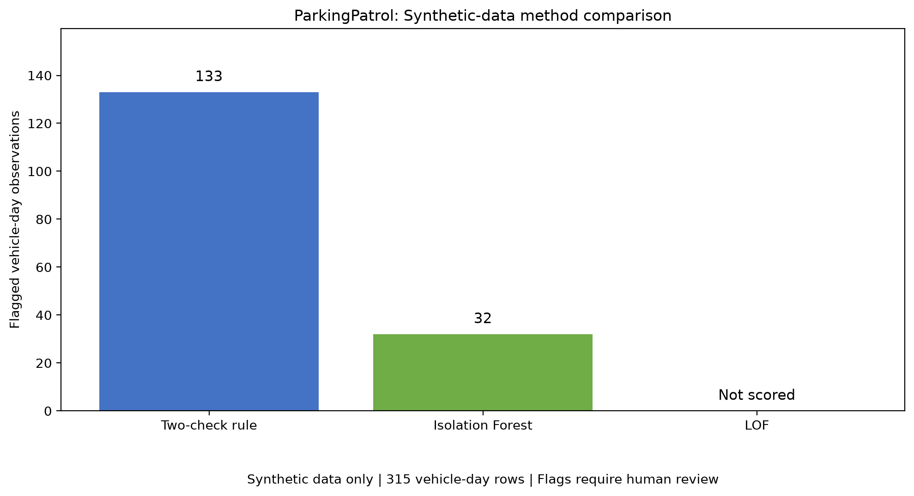

# Slide 1 — ParkingPatrol: Detecting Unusual Parking Patterns

## The Problem
- A customer-only parking lot has 38 spaces.
- Staff manually record vehicles during one or two inspections per day.
- Repeated observations may indicate unusual parking patterns.
- Observations alone cannot prove a parking violation.

## Research Question
Can unsupervised machine learning identify unusual repeat-parking observations compared with a simple rule-based approach?

## Methods
- Rule-based detection
- Local Outlier Factor (LOF)
- Isolation Forest

## Data
- Approximately 10 days of initial real-world observations.
- Separately generated synthetic data for software testing and demonstrations.

## Slide 2 — How ParkingPatrol Collects Data

- Customer-only parking lot with 38 spaces.
- Staff usually inspect twice daily, sometimes once.
- Google Forms records observed vehicles and timestamps.
- Google Sheets stores the inspection records.
- Arrival and departure times are not measured.
- Python analyzes observation patterns, not confirmed violations.

## Slide 3 — Understanding the Dataset

### Real Parking Data
- Initially available: approximately 10 days of observations.
- 38 parking spaces, with usually one or two inspections daily.
- No recorded arrival or departure times.

### Synthetic Dataset
- 10 simulated days.
- 18 fictional inspection rounds.
- 448 fictional vehicle sightings.
- Generated reproducibly using random seed 120.

### Important Limitation
- Synthetic records are used for testing and demonstrations only.
- Repeated observations do not prove unauthorized parking.

## Slide 4 — Data Cleaning and Feature Engineering

### Data Cleaning
- Normalize vehicle identifiers and timestamps.
- Remove duplicate vehicle observations within the same inspection.
- Preserve incomplete inspections and identify missing information.

### Feature Engineering (Implemented)

Six numerical features are calculated for each vehicle-day:

1. `same_day_distinct_checks` — Distinct inspections observing the vehicle that day.
2. `distinct_days_30d` — Distinct observation days within the 30-day window.
3. `area_completed_checks_day` — Completed inspection opportunities for that area and day.
4. `observed_fraction_day` — Fraction of completed inspections observing the vehicle.
5. `distinct_areas_day` — Number of distinct areas observing the vehicle that day.
6. `check_hour_span` — Time span between recorded observations, not parking duration.

These features provide consistent inputs for the rule-based and machine-learning comparison.

### Why It Matters
- Models need consistent numerical inputs.
- Missing observations do not prove that a vehicle was absent.

## Slide 5 — Rule-Based Suspicious Parking Detection

### Existing Rule
- Flag a vehicle observed in two or more distinct inspection rounds on the same local day.
- Duplicate entries within one inspection count only once.
- A day with one inspection cannot trigger the two-check rule.

### Example
- Vehicle SYN_0001 appears during the 9:00 AM and 3:00 PM checks.
- Result: Suspicious — requires human review.

### Limitations
- Two observations do not prove continuous parking.
- Suspicious does not mean a confirmed violation.
- Historical Violator status requires verification of a previously issued ticket.

## Slide 6 — Unsupervised Machine Learning

### Local Outlier Factor (LOF) — Implemented, but Not Scored

- LOF compares the density around each observation with the density around its neighbours.
- The implementation includes a safeguard for heavily duplicated feature patterns.
- In the synthetic dataset, all 315 vehicle-day rows returned `duplicate_neighborhood`.
- Therefore, LOF produced no usable scores for this experiment.
- "Not scored" does not mean zero anomalies.

### Isolation Forest — Implemented

- Isolation Forest uses random partitions to identify unusual combinations of features.
- It flagged 32 of 315 synthetic vehicle-day observations.
- These are exploratory, in-sample review signals, not verified parking violations.

### Model Comparison

- Both ML methods use the same six-feature vehicle-day representation.
- The two-check rule flagged 133 of 315 synthetic observations.
- Isolation Forest flagged 32; LOF was not scored.
- Neither method establishes offender-detection accuracy.
- All review signals require human interpretation and verification.

## Slide 7 — Model Comparison and Findings

### Synthetic Dataset Results

| Method | Flagged Vehicle-Day Rows | Interpretation |
|---|---:|---|
| Two-check rule | 133 | Repeated sightings during distinct same-day inspections |
| Isolation Forest | 32 | Unusual feature combinations |
| LOF | Not scored | Duplicate-neighbourhood safeguard activated |

- Total: 315 fictional vehicle-day observations.
- These counts come from reproducible synthetic data.
- The methods identify review signals, not confirmed offenders.

### Visualization

Generated using `model_comparison_chart.py`.

### Key Findings

- The two-check rule flagged more observations than Isolation Forest.
- The synthetic dataset contained only 23 distinct numerical feature patterns.
- Heavy duplication prevented conservative LOF scoring.
- Different flag counts do not establish which method is more accurate.
- No independently verified offender labels were used to calculate accuracy.

### Interpretation

Isolation Forest can help prioritize unusual observation patterns for human review.

However, synthetic-data results cannot establish real-world effectiveness or justify automatic ticketing or towing.

## Slide 8 — Conclusions, Limitations and Future Work

### Conclusions

- ParkingPatrol successfully compares rule-based detection with exploratory unsupervised machine learning.
- The two-check rule flagged 133 of 315 synthetic vehicle-day observations.
- Isolation Forest flagged 32 observations.
- LOF could not produce usable scores because of heavily duplicated feature patterns.
- These results demonstrate different review approaches, not offender-detection accuracy.
- Human verification is required before any enforcement decision.

### Limitations

- Only 23 distinct numerical feature patterns appeared among 315 synthetic vehicle-day observations.
- The synthetic dataset does not establish real-world accuracy or effectiveness.
- The initial real-world observation period is approximately 10 days.
- Staff inspect the lot only once or twice daily.
- Actual vehicle arrival, departure, and parking duration are unknown.
- Repeated observations cannot prove continuous parking or unauthorized use.

### Future Work

- Collect more real observations with appropriate privacy safeguards.
- Evaluate detection methods against independently verified historical outcomes.
- Investigate DBSCAN and HDBSCAN clustering for duplicated feature patterns (GitHub Issue #16).
- Evaluate model stability and sensitivity to inspection frequency.
- Improve secure Google Sheets integration.
- Keep human verification separate from automated review signals.

### Final Takeaway

ParkingPatrol can help prioritize parking observations for human review, but it cannot independently determine whether a vehicle violated parking rules.
